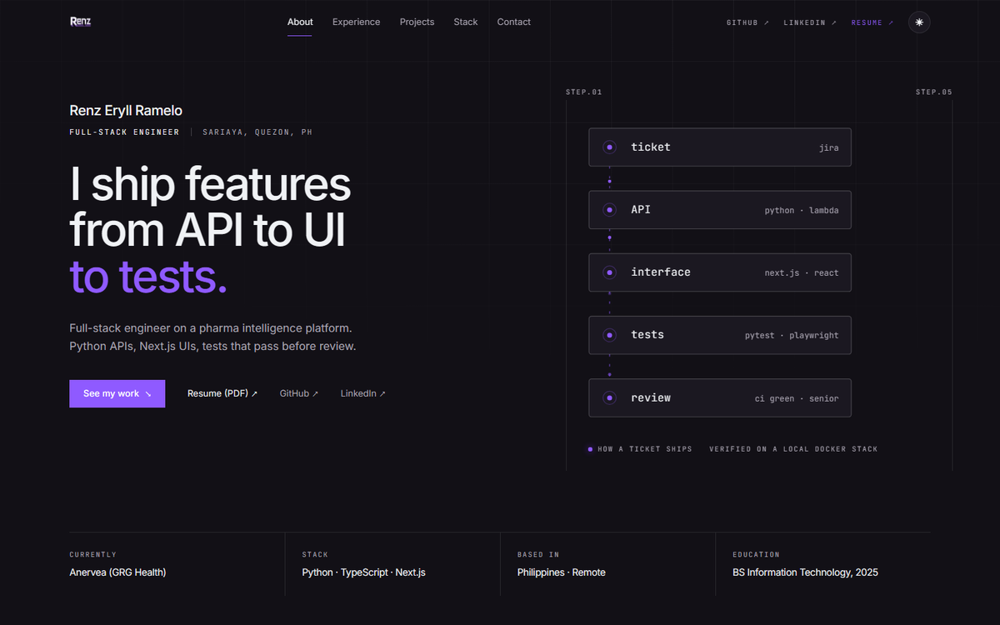

<p align="center">
  
</p>

##

<p align="center">
  
  
  
  
</p>

<h1 align="center">🚀 Renz Portfolio v2</h1>

<p align="center">
  My personal portfolio: experience, selected projects and stack as a full-stack engineer.<br/>
  Built with <b>React 19</b>, <b>TypeScript</b> and <b>Tailwind CSS 4</b> on <b>Vite</b>, with no UI or animation libraries.
</p>

---

## ✨ Features

- 🎨 Clean editorial design built on a coordinate-grid motif, in a violet / ink palette
- 🌗 Light and dark mode that follows the system setting and remembers your choice
- 🗂️ All content in one file, [`src/data/profile.ts`](src/data/profile.ts), so updates need no component changes
- 🖼️ Featured projects with live links, source links and a screenshot gallery
- 🌀 Scroll reveals driven by a single `IntersectionObserver`, respecting `prefers-reduced-motion`
- 📄 One-click resume download
- 📱 Responsive from phone to desktop

---

## 🗂️ Project Structure

```
src/
├── data/profile.ts        # all portfolio content: profile, roles, projects, skills
├── components/site/       # page sections: Nav, Hero, About, Experience, Projects, Toolkit, Contact
└── styles.css             # design tokens (light + dark) and motion utilities
public/
├── images/                # project screenshots and logos
└── files/                 # resume PDF
```

---

## ⚡ Quick Start

Follow these steps to get a local copy of the project up and running.

### 1️⃣ Clone the repository

```bash
git clone <repository-url>
cd portfolio_v2
```

### 2️⃣ Install dependencies

```bash
npm install
```

### 3️⃣ Start the development server

```bash
npm run dev
```

Open **http://localhost:5173** in your browser to view the portfolio 🚀

### Other scripts

```bash
npm run build     # production build to dist/
npm run preview   # serve the production build
npm run lint      # ESLint + Prettier checks
```

---

## 📧 Contact

- **Name**: Renz Eryll Ramelo
- **Email**: [renzeryll09@gmail.com](mailto:renzeryll09@gmail.com)
- **LinkedIn**: [www.linkedin.com/in/renz-eryll-ramelo](https://www.linkedin.com/in/renz-eryll-ramelo)
- **GitHub**: [https://github.com/Renz-Eryll](https://github.com/Renz-Eryll)
